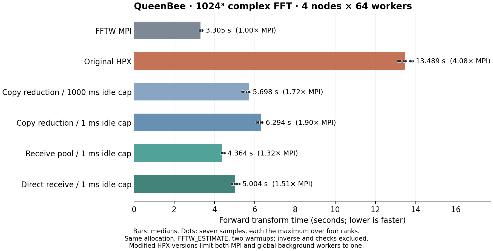
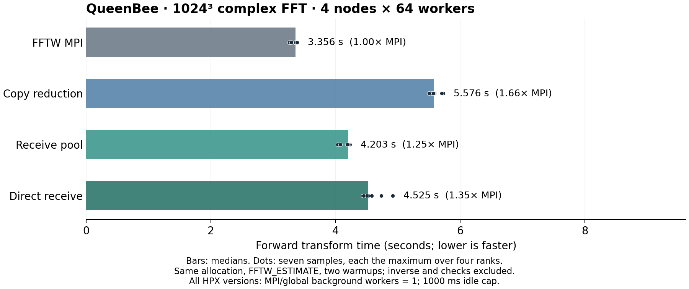

<!--
Copyright (c) 2026 Dominic C. Marcello

This report is free software/documentation; you can redistribute it and/or
modify it under the terms of the GNU General Public License as published by
the Free Software Foundation; either version 2 of the License, or (at your
option) any later version.

This report is distributed in the hope that it will be useful, but WITHOUT ANY
WARRANTY; without even the implied warranty of MERCHANTABILITY or FITNESS FOR
A PARTICULAR PURPOSE. See the GNU General Public License for more details.

You should have received a copy of the GNU General Public License along with
this report; if not, write to the Free Software Foundation, Inc., 51 Franklin
Street, Fifth Floor, Boston, MA 02110-1301 USA.

-->

# QueenBee HPX communication optimization

The optimized implementation completed the unchanged 1024³ benchmark in
**4.203216 seconds**, versus **3.356003 seconds for FFTW MPI**, in the final
confirmation. HPX now takes **1.2524 times MPI's time**, or **25.24% longer**.
The original implementation took roughly four times MPI's time.

The fixes remove deep payload copies, reuse receive storage, and apply an
explicit HPX startup profile limiting MPI and global background workers to one.
In the controlled receive comparison, original HPX took 13.488788 seconds and
pooled HPX took 4.364491 seconds: a **3.0906-fold speedup** and **67.64% less
time**, with its own MPI control at 3.305405 seconds. Final confirmation
restored the normal 1000 ms idle-backoff cap and retained pooling. These are
distinct cohorts; all ratios below use the control from the same allocation.

Wire zero-copy was already enabled. The unnecessary ownership copies and
repeated receive allocation were in the bridge. An additional direct-receive
prototype passed correctness checks but was slower than the pool in both
receive comparisons, so it is retained as experimental evidence only. The
final implementation keeps the last receive copy into FFTW's array and can
retain one idle message block per precision until cleanup (1 GiB per locality
for this workload).

Identical normalized plans and full-spectrum and roundtrip checks support all
accepted timings. The benchmark driver, FFTW algorithms and core libraries
were unchanged. The runtime limits must be supplied at HPX startup; the
library does not silently change application-wide scheduling defaults.

## Workload and controls

Every reported cluster comparison uses the same double-precision, in-place,
normal-layout complex 3D transform: **1024 × 1024 × 1024**, four ranks/localities,
one per node, and 64 workers per rank. The logical array is 16 GiB globally,
with a reported maximum local FFTW allocation of 4 GiB. Both backends use
`FFTW_ESTIMATE`, two warmups, and seven timed forward samples. A barrier
precedes each sample; the timer covers only forward execution, and the
published sample is the maximum local elapsed time over ranks. Inverse
execution, normalization, checks and reporting are outside that timer.

The unchanged driver checks the full forward spectrum and initial and final
roundtrips at tolerance `1e-10`. It prints the complete forward and backward
plans. The comparison script checks numerical results, case metadata, sample
statistics and equality of normalized plans. All accepted runs below passed
those checks. The same FFTW core, thread and MPI archives were retained across
the primary variants; HPX bridge changes did not alter the transform algorithm.
The later tuning cohort reused the primary executables byte-for-byte.
Receive experiments replaced only the bridge object, preserving the other
31 HPX archive members, and final confirmation reused those same executables.

The recorded stack is GCC 13.2, Boost 1.83, HPX 1.11 at commit
`c9b81b401fbe6ba4a0306feff71d18ef01c71b34`, and Open MPI 5.0.11. Builds use
`-O3 -march=native` and FFTW SSE2, AVX and AVX2 support. The common launcher
uses four MPI processes, one per node, with CPU binding disabled and
`numactl --interleave=all`. HPX uses its MPI parcelport, with TCP disabled;
Open MPI uses UCX with `UCX_TLS=rc,sm,self`. APEX is disabled. Exact flags,
launch commands, source and binary hashes are retained with each cohort.
The [installed-header hashes](installed_hpx_source.txt) match the inspected
HPX source revision for the channel, serialization and MPI receive paths.

## Primary uninstrumented results: job 1125395

| Variant | Minimum (s) | Median (s) | Maximum (s) | Median / MPI |
|---|---:|---:|---:|---:|
| Stock FFTW MPI | 3.279476 | 3.320776 | 3.379162 | 1.0000 |
| HPX baseline, default progress | 13.207521 | 13.781111 | 13.941836 | 4.1500 |
| HPX serialization-buffer candidate, default progress | 8.772662 | 8.915882 | 9.117176 | 2.6849 |
| HPX baseline, MPI background workers = 1 | 9.046951 | 10.294787 | 12.002794 | 3.1001 |
| HPX candidate, MPI background workers = 1 | 7.047569 | 8.408285 | 10.214603 | 2.5320 |

At default settings, the candidate removes 4.865229 seconds from the median,
giving a 1.5457-fold speedup over the matching HPX baseline. With one MPI
background worker, the candidate reduces its matching baseline's median by
18.32%. Changing only that progress setting reduces the candidate median by
5.69%; its variation remains substantial.

The executed order was MPI, baseline/default, candidate/default, baseline/one
MPI background worker, then candidate/one MPI background worker. This entire
job completed successfully. See the [primary result summary](1125395/optimization.json),
[raw logs and commands](1125395/),
[executed script](1125395/job.sbatch), and [final status](1125395/FINAL_STATUS).

The earlier 13.416974-second HPX result versus 3.325045-second MPI result from
job 1125135 motivated this work. It is historical context only, not the
baseline or MPI denominator for the primary table above.

## What changed in the communication path

The original point-to-point bridge constructs a sized `std::vector<char>` and
copies the outgoing bytes into it. The sized vector value-initializes its
storage. After transport, HPX's channel server retrieves the payload through
a `T const &`, then **returns `T` by value**. For a vector this is another deep
copy of the received payload. The bridge subsequently copies the returned
bytes into FFTW's receive array. The copy costs therefore extend beyond the
explicit outgoing and final `memcpy` calls.

The candidate changes point-to-point payloads to
`hpx::serialization::serialize_buffer<char>`. Remote outgoing messages refer
to FFTW's source storage, and channel return copies share ownership of received
storage. This removes the explicit outgoing vector construction/copy and the
vector deep copy in channel retrieval. Collective payloads remain unchanged.
The [candidate patch](1125395/candidate.patch) records the exact implementation,
subsequently committed as [`f28b54a`](https://github.com/dmarce1/fftw3-hpx/commit/f28b54a664aa7e345c6b394d36584952020718e4).
The relevant upstream behavior is in HPX's
[channel server get/set implementation](https://github.com/TheHPXProject/hpx/blob/c9b81b401fbe6ba4a0306feff71d18ef01c71b34/libs/full/collectives/include/hpx/collectives/detail/channel_communicator.hpp).

The reference is valid only while the source remains unchanged. `send` waits
for the channel-set action's completion before returning. `sendrecv` obtains
the incoming message, waits for its outgoing channel-set future, and only then
writes the receive array. Consequently exact or partial send/receive overlap
does not overwrite bytes while the referenced send is still using them.
Completion here means that the destination action has stored the message,
after remote serialization/transport has consumed the source; it does not
require the receiver's later FFT to finish.

Self-send is different: no remote serialization creates independent storage,
so the candidate explicitly copies a self-directed message. That lets the
caller overwrite its source after send returns even if receive happens later.
Zero-byte messages use an empty buffer without dereferencing their pointer.
Local assertion-enabled tests cover source overwrite, self-send, zero bytes,
repeated tags and exact/partial overlap. Those local checks are correctness
evidence, not evidence of cluster transport performance.

This change does **not** introduce wire zero-copy. Diagnostic configuration
records already show global and MPI zero-copy send and receive options enabled
in every baseline and candidate run. HPX's MPI receive path deserializes the
parcel metadata, allocates serialization-owned chunk buffers, receives into
those buffers, and dispatches the action after completion. The candidate still
uses temporary owned receive storage and the final copy into FFTW's array.
See the upstream
[MPI receive lifecycle](https://github.com/TheHPXProject/hpx/blob/c9b81b401fbe6ba4a0306feff71d18ef01c71b34/libs/full/parcelport_mpi/include/hpx/parcelport_mpi/receiver_connection.hpp)
and [serialization-buffer ownership](https://github.com/TheHPXProject/hpx/blob/c9b81b401fbe6ba4a0306feff71d18ef01c71b34/libs/core/serialization/include/hpx/serialization/serialize_buffer.hpp).

## Diagnostic profile cohort: job 1125425

Instrumentation was added only after the primary comparison. This separate
job repeated the case with its own MPI control, whose median was 3.314521
seconds. All four instrumented HPX runs completed and retained the same plans.
Each run has 196 metric records and 28 per-rank total records, covering four
ranks and seven forward samples. Each sample's maximum rank total agrees
exactly with its reported SAMPLE time. All 23 runtime configuration fields
were recorded on each rank.

The following rows decompose the **actual rank and sample supplying each run's
median maximum-rank time**. They do not combine independently selected medians.

| Variant | Rank/sample | Total (s) | Thread callbacks (s) | sendrecv (s) | Residual (s) |
|---|---:|---:|---:|---:|---:|
| Baseline/default | 2/5 | 13.546164 | 0.909060 | 9.112491 | 3.524613 |
| Candidate/default | 3/1 | 8.770220 | 0.831907 | 4.093580 | 3.844733 |
| Baseline/MPI background workers = 1 | 0/3 | 11.825169 | 0.968581 | 8.627253 | 2.229335 |
| Candidate/MPI background workers = 1 | 3/5 | 8.379853 | 0.790401 | 5.367725 | 2.221727 |

Each rank/sample executes three timed thread callbacks and six `sendrecv`
calls. These top-level scopes do not nest for the audited forward plan.
Residual is `total - run_jobs - sendrecv`; it includes serial transposes,
other uninstrumented FFT work, wrappers and timing overhead. It is **not a
direct measurement of serial transpose alone** or of CPU versus memory stalls.

Outgoing construction, message construction and final receive-copy timers are
**inclusive subscopes of sendrecv**. Adding them to the table would double-count
time. At default settings, means over the actual critical rank in each sample
show `sendrecv` falling from 9.055913 to 4.218401 seconds, while thread callbacks
change from 0.882813 to 0.801788 seconds and residual from 3.623417 to 3.739733
seconds. The timed outgoing vector scope disappears: 2.831262 seconds in the
baseline, replaced by approximately 3.4 microseconds of message construction.
Final receive copying stays similar, 0.731895 versus 0.745487 seconds.

The remaining time inside sendrecv also falls. That is consistent with removing
the channel's additional deep copy, but the profile cannot separately quantify
serialization, allocator work, internal copies, transport, progress scheduling
or waiting. In particular, it does not measure UCX registration or page faults.

Limiting MPI background workers to one lowers the candidate's mean residual by
1.501663 seconds and its final-copy scope by 0.177811 seconds, but raises its
inclusive sendrecv time by 1.287051 seconds. Its median improvement is therefore
only 4.45% in this diagnostic cohort. Global background workers remain 64 in
all four runs, so this is distinct from the later global-limit experiment.
The changing critical ranks and widened per-sample rank spread are recorded in
the [analysis notes](1125425/analysis/notes.md) and
[complete per-rank tables](1125425/analysis/profiles.txt).

The diagnostic results explain the primary behavior; their instrumented
timings do not replace the primary uninstrumented timings. Full raw logs,
the actual script, configuration, plan checks, analysis and checksums are in
[job 1125425](1125425/README.md).

## Progress tuning: completed runs from partially failed job 1125437

This separate cohort reused the primary binaries and held MPI background
workers at one while changing the global background-worker limit. Each accepted
variant has its own clean launcher completion and comparison record.

| Completed variant | Median (s) | Median / this cohort's MPI |
|---|---:|---:|
| MPI control | 3.333576 | 1.0000 |
| Candidate, MPI background workers = 1 | 8.388131 | 2.5163 |
| Candidate, MPI and global background workers = 1 | 5.559548 | 1.6677 |

The global limit reduces the candidate median by 33.72% relative to the
matching run without that limit. It changes a runtime setting, not the FFT
plan, precision, transform size or sample policy. These runs were not profiled,
so job 1125425's phase decomposition cannot be assigned to this improvement.

The subsequent `hpx.parcel.mpi.multithreaded=0` variant printed numerical PASS
results but then segfaulted during HCOLL context cleanup. Slurm recorded an OOM
kill and the job ended with exit 137. Its timing is excluded. The final variant
combining serialized MPI and the global limit never ran. The logs show both
the shutdown failure and OOM event; they do not establish a causal explanation.
No accepted result requires disabling MPI multithreading. The entire job is
labelled **FAIL**, despite its three earlier completed runs. See the
[partial-cohort evidence](1125437/README.md), including all raw benchmark logs,
the executed script, failure log and accounting.

Job 1125605 independently repeated the successful background-worker settings
before testing receive storage, as recorded below.

## Receive-storage comparison: job 1125605

This job completed all six unchanged-driver runs, three assertion-enabled
four-node communication checks, and pre/post source and binary hash checks.
The copy-reduced control uses one MPI background worker and one global
background worker, with normal multithreaded MPI. A separate control then
changes maximum idle backoff from its 1000 ms default to 1 ms. Both receive
alternatives use exactly that latter configuration.

| Variant | Median (s) | Median / MPI |
|---|---:|---:|
| MPI control | 3.305405 | 1.0000 |
| Original HPX, default runtime | 13.488788 | 4.0808 |
| Copy-reduced HPX, background limits = 1 | 5.698481 | 1.7240 |
| Same, maximum idle backoff = 1 ms | 6.294205 | 1.9042 |
| Receive pool, same 1 ms runtime | 4.364491 | 1.3204 |
| Direct receive, same 1 ms runtime | 5.004054 | 1.5139 |



Reducing the idle-backoff cap **increased** the candidate's median by 10.45%.
It is not accepted as a performance improvement. Against the correct 6.294205 s
control, the receive pool reduced time by 30.66%, and direct receive by 20.50%.
The pooled implementation is 3.0906 times faster than original HPX in this
allocation, with 67.64% less elapsed time, while still taking 32.04% longer than
MPI. The later confirmation below restores the normal idle setting.

The pool caches **one idle receive block per precision**, reusing only exact
sizes and retaining the largest returned block. It never reuses a live message's
storage or waits for an owner to release it. Cleanup frees idle storage and
disables that epoch, so late releases or delayed old-epoch messages cannot
refill a new pool. The cache can retain up to the largest returned message
per precision, 1 GiB per locality here, until cleanup. The final copy into
FFTW's destination remains. This isolates the benefit of reusing receive
storage, including any consequences for allocation, page mappings and transport
registration; those underlying costs were not separately measured.

The direct-receive alternative registers an exact group/source/sequence-tag
and byte count before sending, and deserializes into that destination when a
safe registration is already available. Early messages fall back immediately
to owned storage; self-sends and overlapping exchanges keep the owning path.
No waiting is added to parcel deserialization. It passed the same checks but
was slower than the pool here. We did not instrument direct-hit frequency or
registration costs, so the measured result does not establish why it lost.
The integrated implementation uses the pool; both frozen alternatives and
candidate-relative patches remain in [receive_prototypes](receive_prototypes/README.md).

The [raw results and provenance](1125605/README.md) include all plans, launch
commands and the exact 32-member archive comparison: each prototype replaces
only `hpx-comm.o`; the other 31 members are identical. The integrated pooled
source's SHA-256 is
`57945a07f87200293e8967c7dd5aed81b869f5e1b257692f297dbac99f62634c`.
It is committed as [`9908a29`](https://github.com/dmarce1/fftw3-hpx/commit/9908a29683202d86496cd0d93a9dcb7bf553b1a4).
All local double/single/long-double correctness matrices, deterministic
ownership tests and source hashes are in
[receive_validation](receive_validation/README.md). The integrated library
then passed normal builds in all three precisions, all new message-ownership
checks and assertion-enabled communication checks, followed by full standard
double `make check`, including serial, pthread, callback and all five HPX
numerical configurations. See [integration validation](integration_validation/README.md).
The new `hpx-message-check` is part of `make -C hpx check`; assertion-based
checks reject builds that leave `NDEBUG` defined.

Recreate the figure with Python and Matplotlib:

```sh
python3 plot_results.py 1125605 receive_results
```

## Final runtime confirmation: job 1125688

This complete job reused the exact binaries from the preceding successful
cohort, with normal **1000 ms maximum idle backoff**, one MPI and one global
background worker, and multithreaded MPI enabled for all three HPX variants.
All 28 timing samples, 12 numerical checks, normalized forward/backward plans
and pre/post source and artifact checks passed. Slurm reports COMPLETED with
exit `0:0`. The node set was again qbd028, qbd029, qbd053 and qbd054.

| Variant | Median (s) | Median / MPI |
|---|---:|---:|
| MPI control | 3.356003 | 1.0000 |
| Copy-reduced candidate | 5.576087 | 1.6615 |
| Pooled receive (integrated) | **4.203216** | **1.2524** |
| Direct receive (experimental) | 4.524689 | 1.3482 |



Pooling reduced the matching candidate's median by **24.62%**, or 1.372871
seconds. Direct receive again lost to pooling. The final result is **25.24%
slower than MPI**; it does not establish parity. The previous cohort's idle-cap
comparison rejected 1 ms as a general improvement, and this confirmation
validates the final pooled implementation with the normal 1000 ms setting.
The two pool measurements span separate allocations and therefore do not
isolate a causal pool-specific backoff effect.

Use the [documented HPX startup profile](../../../hpx/README.md#local-and-cluster-transports)
to reproduce the selected background-worker limits. The unchanged benchmark
already forces MPI transport and disables TCP; its documented invocation now
also supplies these measured runtime settings. The exact executed commands,
raw logs, independent statistics and provenance are in
[job 1125688](1125688/README.md). Recreate this figure with:

```sh
python3 plot_results.py 1125688 final_results final
```

The full final evidence archive has SHA-256
`9e7ac02bac1ae45081e067bd73ef46f4a1dd618be79708dff6163f1d546f92b3`.
The receive-comparison archive has SHA-256
`6750feafac574ab8898bd8ee99dd312729a7a8d61008224c5cb547ba9c1a57cb`.
The repository retains text evidence and source snapshots rather than compiled
executables. [SHA256SUMS](SHA256SUMS) covers all retained files, with additional
per-directory manifests.

QueenBee access consumed **4 of the original 12 authorized login attempts**
across the entire task, including the initial failed authentication and the
user's manual MFA login. All optimization commands and transfers shared one
persistent connection; the benchmark connection was closed after collecting
these results. No TCP parcel transport was used on QueenBee.

## Limits and retained failures

These are seven samples in a fixed execution order within one allocation per
cohort. They are not randomized crossover trials or repeated independent
allocations. They do not support a confidence interval for general cluster
performance, and sample indices across variants are not paired machine states.
The default candidate's strong copy-path improvement is supported by both the
primary and diagnostic cohorts, but exact gains and progress-setting effects
vary between them. Every ratio uses the MPI control from the same cohort.

Primary and diagnostic jobs ran on qbd133, qbd381, qbd447 and qbd459, with
64-core, two-socket Xeon Platinum 8358 nodes. Their inventory reports four NUMA
domains on three nodes and two on the fourth. The tuning nodes qbd028, qbd029,
qbd053 and qbd054 all report four domains. Interleaving across all domains and
disabling CPU binding do not remove differences in NUMA topology or scheduling.
The one-CPU inventory step's affinity output is not the benchmark worker mask.

The separate assertion-check job [1125426](1125426/README.md) compiled but failed
during HPX initialization because its executed launch supplied an unknown TCP
configuration key to an HPX installation without that parcelport. It ran no
communication assertions. Its exact script and error are preserved. The corrected runner uses
`hpx.parcel.tcp.enable!=0` to define the disabled entry even when TCP is compiled
out. All three corrected communication gates passed in job 1125605.

Job 1125329 was cancelled during replacement with a shorter allocation; it
had completed builds and one MPI sample by the time cancellation arrived.
Its partial timings are discarded. Jobs 1125547 and 1125577 were cancelled
while pending, with no nodes or runtime, to correct the launcher and then
remove a failed dependency. Their records are retained in the access ledger.

The measured gains apply to this plan, machine and resource count. The pool
and reduced background work remove major costs without modifying FFTW's
algorithms or thread callback. These experiments do not identify every part
of the remaining MPI gap or establish performance for other workloads.

## License and upstream citation

The HPX changes, test tools and added documentation are Copyright (c) 2026
Dominic C. Marcello, licensed under GPL version 2 or (at your option) any later
version; see [COPYING](../../../COPYING). Upstream notices remain unchanged.
The FFTW algorithms are from the [official FFTW 3.3.11 tarball](https://fftw.org/fftw-3.3.11.tar.gz).
Cite Matteo Frigo and Steven G. Johnson, “The Design and Implementation of
FFTW3,” *Proceedings of the IEEE* 93(2), 216–231 (2005),
[DOI: 10.1109/JPROC.2004.840301](https://doi.org/10.1109/JPROC.2004.840301).
