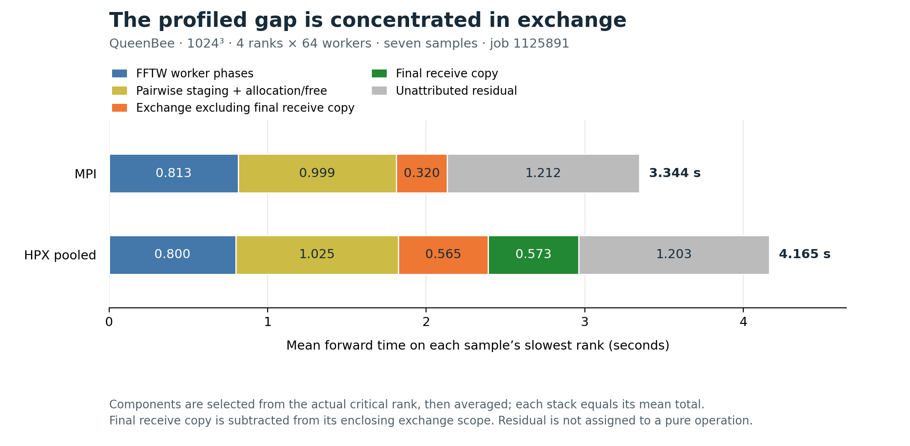
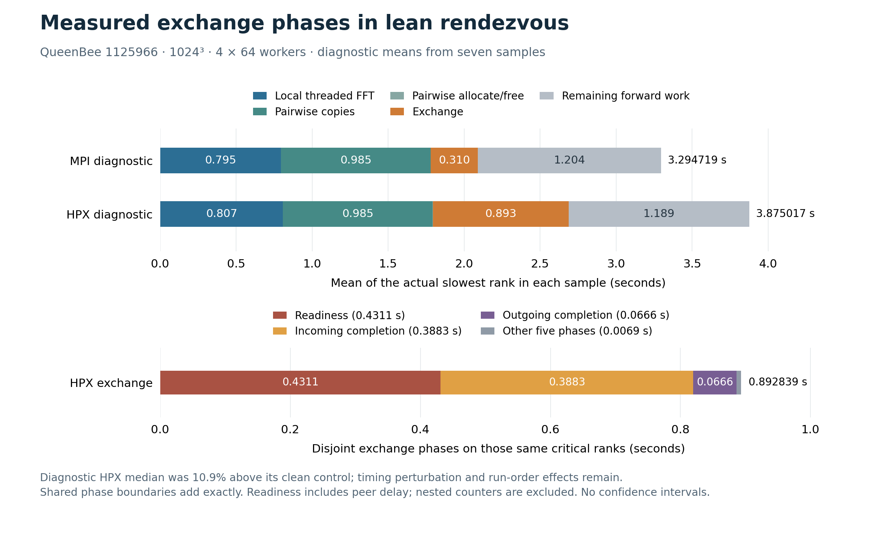

<!-- Copyright (c) 2026 Dominic C. Marcello. SPDX-License-Identifier: GPL-2.0-or-later -->

# Direct reception into FFTW storage

This implementation and report are licensed under the GNU General Public
License, version 2 or any later version, without warranty; see
[COPYING](../../../COPYING). Upstream FFTW notices remain unchanged.

The remaining pooled-HPX overhead was concentrated in communication. Profiling
identified a final receive copy averaging 0.573 seconds on the critical rank.
The new bridge posts FFTW's existing destination before sending a readiness
notification. HPX can then receive the large payload into that address directly.
FFTW retains allocation and deallocation ownership; no FFTW allocator change
or distributed FFT algorithm change is needed.

The final cohort, job 1125974, measured the lean direct-receive implementation
at **3.489 seconds**, versus MPI bookends of **3.279 and 3.312 seconds**:
**5.4–6.4% overhead**. This uses a 10 ms HPX idle-backoff cap. Its median was
10.96% and 1.24% below the surrounding 1000 ms HPX controls, respectively.
The shorter cap is selected for this wall-time profile, with a tradeoff:
its diagnostic used more process CPU time. No extra cores were allocated.

Variation matters: earlier lean cohorts measured roughly 9–18% overhead,
and direct reception with the original HPX build did not consistently improve
elapsed time. All positive and negative cohorts are retained below. The
receive-copy removal is verified; the selected settings do not establish MPI
parity or a general speedup for other sizes or locality counts. The remaining
communication/progress overhead has not been eliminated.

## Fixed comparison

Every primary run keeps [matched_3d.cpp](../../matched_3d.cpp) byte-identical:
SHA256 `9327f8e3e9bb4a78509e7e12f11c093125dd67cdc0ab6b56fbdb8728fc7c4d41`.
The workload remains a 1024³, double-complex, in-place transform with normal slab
layout and FFTW_ESTIMATE. Four exclusive physical nodes each run one MPI rank
or one HPX locality with 64 FFT workers. Both use Open MPI 5.0.11 built with
GCC 13.2, the same FFTW serial/thread archives and identical normalized plans.

Each run has two forward/inverse warmups and seven timed forward transforms.
A sample is the maximum rank elapsed time; medians are over those seven maxima.
Planning, synchronization, inverse transforms, normalization, timing reduction
and verification are outside the forward timer. Full dense-spectrum validation
and initial/final roundtrips must pass at the unchanged 1e-10 tolerance.
No global array gather is used by this driver.

HPX uses its MPI parcelport with TCP compiled out and forcibly disabled.
Open MPI uses UCX with `UCX_TLS=rc,sm,self`, `OMPI_MCA_pml=ucx` and
`OMPI_MCA_btl=self,sm`. Placement is one unbound process per node with
`numactl --interleave=all`. Both the global and MPI background-worker limits
are one, MPI multithreading is enabled, and the selected `sendimm` setting is
zero. Earlier controls use a 1000 ms idle-backoff cap; the final selected profile
uses 10 ms. Runtime variations are explicitly labeled: `sendimm=1` in job
1125925 and the 1 ms cap in job 1125945 were rejected; job 1125974 compares
10 ms against repeated 1000 ms controls. See [startup instructions](../../../hpx/README.md#local-and-cluster-transports)
and the archived full commands for reproducible settings.

## Where the time went

[Profile job 1125891](profile/README.md) measures disjoint components on the
actual slowest rank of each sample. Averaging those components preserves
additivity; independent component medians are not summed.

The profiled mean total gap was 0.820718 seconds. The inclusive exchange gap
was 0.817864 seconds, 99.65% of that difference. Final receive copying alone
averaged 0.572967 seconds, about 69.8% of the gap. FFTW worker phases and
existing pairwise staging copies were similar between backends. This supports
removing the receive copy while preserving FFTW's algorithms and callback.

The receive pool served 166 of 168 allocations, with both misses in sample zero;
none of the selected critical ranks allocated receive storage. Repeated heap
allocation therefore was not the recurring bottleneck. HPX used more CPU time
outside FFTW's worker bodies, but those measurements do not independently
identify idle polling, parcel progress or another subsystem as the cause.
The report separates diagnostic perturbation and inclusive scopes from primary
performance measurements.

## Allocation ownership and readiness

The [production bridge](../../../hpx/hpx-comm.cpp) retains FFTW-owned source
and destination addresses. A remote disjoint `sendrecv` registers its exact
destination using group, source and sequence/tag as the key, then announces
readiness to its receive source. It waits for readiness from its send
destination before releasing the payload. This also works when the send
destination and receive source differ.

The receiver decodes the match key before its array payload, checks the exact
byte count and claims the posted destination once. HPX's array serialization
exposes that borrowed address to its large-chunk MPI receive. Registration stays
valid until receive completion, and the source stays valid through send
completion. The bridge never frees a borrowed FFTW array.
Direct MPI reception requires HPX's array/chunk and send/receive zero-copy
optimizations to remain enabled. These 1 GiB payloads exceed the configured
8192-byte threshold. Other settings remain correct but may copy inside
deserialization. The [parcelport source audit](parcelport_path.md) follows the
exact pointer through serialization to `MPI_Irecv` and records those conditions.

Standalone, self, empty and overlapping messages participate in readiness
matching too. Eager fallback sends consume notifications without waiting;
this supports the tested mixed exchanges with direct-capable peers. Arbitrary
schedules that rely on eager buffering to break circular dependencies are not
guaranteed, as with portable MPI. FFTW's matched pairwise rounds satisfy the
required ordering. Owned
fallback buffers preserve source-reuse and overlap semantics. In particular,
the bridge completes the outgoing send before copying an overlapping receive.
The exact-size receive pool remains for those paths.

This removes the extra bridge receive copy. FFTW's own pairwise staging copies
remain. It is not a claim of end-to-end copy-free networking: MPI/UCX and
hardware can have their own staging or registration behavior. HPX retains
per-tag channel metadata for data and readiness until group cleanup; its size
grows with the message count. Group operations must remain sequential, as in
the existing bridge contract. See [MPI_MAPPING.md](../../../hpx/MPI_MAPPING.md)
for the supported operations and differences from general MPI semantics.

## Candidate comparison: job 1125899

All seven primary cases below used one allocation and the same workload.
The old pooled executable is retained as an additional historical control;
`release pool` is the same-flags baseline for candidate code comparisons.

| Primary case | Median seconds | Minimum | Maximum |
| --- | ---: | ---: | ---: |
| MPI | 3.266203 | 3.238313 | 3.289767 |
| Existing pooled executable | 4.718505 | 4.026685 | 4.847704 |
| Release pool (`-DNDEBUG`) | 4.138596 | 3.968339 | 4.542948 |
| Release pool, lean HPX | 4.031525 | 3.974601 | 4.359817 |
| Parallel final copy | 3.623516 | 3.581973 | 4.857166 |
| Opportunistic direct receive | 4.039348 | 3.848819 | 4.362774 |
| **Readiness plus direct receive** | **3.583454** | **3.511516** | **3.767918** |

The readiness implementation was selected before final confirmation. The
parallel-copy alternative improved the median but retained the extra memory
traffic and had a larger observed spread. Merely registering a destination
without waiting for readiness frequently let data arrive first.

Separate counter-instrumented runs establish what each receive path did:
opportunistic reception hit 94 of 168 posted destinations (55.95%) and made 74
final copies. Readiness hit all 168, six per rank/sample, with zero final-copy
calls or bytes and zero fallback allocations. Their instrumented timings are
not included in the primary table. [Candidate evidence](candidate/README.md)
contains raw samples, all correctness gates, 616 diagnostic rows and compact
recomputed summaries.

The old pooled executable's variable timing does not prove a large assertion
cost: the earlier controlled profile cohort measured only a 0.19% difference
between it and the same source with `-DNDEBUG`. Candidate order is fixed and
not randomized, so individual small differences are descriptive observations.

## HPX build options

The [compile audit](compile_audit.md) checks the actual QueenBee cache, compiler
commands, installed configuration and dependencies. The original HPX was
already Release with `-DNDEBUG`. Lock verification, lock backtraces, spinlock
deadlock detection, thread debug/backtrace features, sanitizers, Valgrind and
ITT notification were disabled. The bridge now also explicitly uses release
assertion settings, while its correctness tests force assertions on.

The [lean HPX build](lean_hpx/README.md) uses the same source commit, compiler
and Open MPI, but compiles out APEX, parcel profiling, logging, I/O counters and
cumulative thread counts. APEX-required thread descriptions/parent references
also disappear. MPI and MPI multithreading stay enabled; TCP stays disabled.
All 170 seeded options and 377 compile commands were audited, and the original
installation was hash-verified unchanged. Lean HPX changes several facilities
together; its timing cannot identify the cost of any one facility.

## Confirmation: job 1125925

[Confirmation evidence](confirmation/README.md) preserves all five primary
runs, two lean communication gates, the exact nine-file input bundle, archive
proofs and source/binary/dependency hashes. The same four-node allocation ran
the cases in the following order:

| Case | Median seconds | HPX / MPI |
| --- | ---: | ---: |
| MPI | 3.277329 | 1.0000 |
| Release pool, original HPX | 4.217723 | 1.2869 |
| Direct receive, original HPX | 4.334013 | 1.3224 |
| Direct receive, lean HPX | 3.869754 | 1.1808 |
| Same lean binary, `sendimm=1` | 8.298037 | 2.5320 |

All cases passed spectrum and both roundtrip checks and used identical plans.
Immediate send is rejected: it more than doubled the lean runtime here. The
ordinary `sendimm=0` setting is retained. The lean build improved this cohort,
but direct reception with the original build regressed slightly against the
pooled control. The code-level removal of final copies is established by the
counter audit; elapsed-time improvement is not equally repeatable.

The [parcelport audit](parcelport_path.md) identifies a readiness-specific idle
window worth testing. Before an incoming header is noticed, no active payload
connection may keep the progress callback marked busy. After 200,000 empty
scheduler iterations, the scheduler can sleep for up to its 1000 ms backoff cap;
an unobserved MPI arrival does not directly notify that condition variable.
This is a source-supported hypothesis, not proof that sleeping caused the
observed variation. The bounded follow-up below tests it. The previous
pooled-bridge cap test does not settle this new readiness protocol's behavior.

## Sleep-cap comparison with repeated controls: job 1125945

This job reused exactly the same lean executable, fixed `sendimm=0`, and changed
only `hpx.max_idle_backoff_time` from 1000 ms to 1 ms and back. Both lean
settings passed fresh four-locality communication checks before timing. All
42 samples, 18 numerical checks, plan comparisons and preservation gates passed.

| Case, in executed order | Median seconds |
| --- | ---: |
| MPI, start | 3.322516 |
| Release pooled bridge | 4.139570 |
| Lean direct receive, 1000 ms | 3.607723 |
| Same lean executable, 1 ms | 3.690353 |
| Lean direct receive, 1000 ms repeated | 3.648197 |
| MPI, end | 3.273913 |

The 1 ms cap had a tighter observed spread but was 2.29% slower than the initial
lean median and 1.16% slower than its repeated control. It is not selected.
At this stage, the 1000 ms cap and `sendimm=0` were retained. MPI's
bookend median improved 1.46%; the repeated lean median worsened 1.12%.
These controls expose temporal variation rather than eliminate it. The two
lean controls are 8.6–11.4% above the two MPI controls; neither baseline is
silently discarded. [Progress evidence](progress/README.md) retains every
sample and command, the frozen input bundle and compact recomputed summaries.
The experiment does not establish readiness-induced sleep as the remaining
bottleneck.

## Direct-path phase profile and MPI thread level: job 1125966

The [direct-path profile](lean_profile/README.md) keeps clean controls separate
from diagnostics and the auxiliary MPI thread-level run. All five cases passed
35 timed samples, 15 numerical checks and identical normalized plans.

| Role and case | Median seconds |
| --- | ---: |
| Primary MPI | 3.280053 |
| Primary lean direct receive | 3.580327 |
| Instrumented MPI | 3.291248 |
| Instrumented lean direct receive | 3.971094 |
| Auxiliary MPI with `MPI_THREAD_MULTIPLE` | 3.338921 |

The primary HPX/MPI ratio is **1.0915**. The instrumented MPI median was 0.34%
above its clean control, but instrumented HPX was 10.91% above its control.
That larger difference includes possible instrumentation and temporal effects;
the diagnostic decomposition must not be treated as the exact cost breakdown
of the clean run.

Within the diagnostic runs, arithmetic means on each sample's actual slowest
rank give a total gap of 0.580298 seconds. The inclusive exchange difference is
0.582920 seconds; other disjoint components sum to a small negative difference.
Across each forward transform's six exchanges, HPX phases average 0.431114
seconds in readiness, 0.388283 seconds waiting for incoming data, and 0.066587
seconds waiting for outgoing action completion. Posting, initiation, finish and cleanup together account for about
0.006855 seconds. All phase nanoseconds sum exactly to exchange time.

All 168 large loads (168 GiB across the measured rank/sample records) required
and used posted destinations. Owned fallback, pool allocation and final memcpy
counts and bytes are zero. The copy removal remains verified. The largest
per-rank/per-sample readiness total is 0.847801 seconds, but readiness includes
peer arrival, packing skew and token progress. It is not pure network time or
proof of scheduler sleep. The older cap-1 experiment's tighter spread and the
new readiness profile motivate a bounded intermediate-cap test; they do not
establish a cause by themselves.

Both backends resolve the same Open MPI 5.0.11 installation. Fresh four-rank
probes observed `MPI_THREAD_FUNNELED` with the ordinary environment, and
`MPI_THREAD_MULTIPLE` under the process-local override
`OMPI_MPI_THREAD_LEVEL=3`, whose behavior is documented by
[Open MPI](https://docs.open-mpi.org/en/v5.0.x/man-openmpi/man3/MPI_Init_thread.3.html).
The unchanged MPI executable's auxiliary median was 1.79% above the original
baseline. This fixed-order comparison does not isolate temporal variation,
and the auxiliary result does not replace the primary baseline. The fresh
probe also does not establish what historical executions actually provided.

## Intermediate backoff cap: job 1125974

The [final runtime-only comparison](readiness_progress/README.md) reuses the
same clean and diagnostic binaries; nothing is rebuilt. All 42 samples,
18 numerical checks, normalized plans, two fresh communication gates and
input/binary preservation checks pass. Only the idle-backoff cap changes
between the three clean HPX cases.

| Case, in executed order | Median seconds | Observed range |
| --- | ---: | ---: |
| MPI, start | 3.278653 | 3.249225–3.365882 |
| Clean lean HPX, 1000 ms | 3.918801 | 3.465386–4.056532 |
| **Clean lean HPX, 10 ms** | **3.489162** | **3.445888–3.560634** |
| Clean lean HPX, 1000 ms repeated | 3.533079 | 3.390573–3.603847 |
| MPI, end | 3.311602 | 3.289579–3.369088 |
| Diagnostic lean HPX, 10 ms | 3.529916 | 3.482905–3.667135 |

Cap 10 is selected for the documented wall-time profile: its median is below
both surrounding controls, by 10.96% and 1.24%. The second difference is small,
and the repeated 1000 ms control improved 9.84%; MPI's median increased 1.00%.
Those changes expose temporal variability. They limit attribution of the full
improvement to the cap and preclude a broad reproducibility claim from this
single fixed-order cohort. The measured HPX/MPI ratio is 1.0536–1.0642 against
the two unchanged MPI bookends.

The separate cap-10 diagnostic is 1.17% above its clean median. Across each
forward's six exchanges, its critical-rank readiness mean is 0.126788 seconds,
incoming wait is 0.321021 seconds, and outgoing completion wait is 0.057460
seconds. Its largest all-rank/per-sample readiness total is 0.237570 seconds.
All 168 measured payloads still use required posted destinations, with no owned
fallback allocation or final memcpy. Phase partitions remain exact.

The preceding cap-1000 diagnostic measured readiness mean 0.431114 seconds
and maximum 0.847801 seconds. The reduction is consistent with the intended
progress effect, but these are separate runs, not a paired causal isolation of
sleep time. No earlier MPI diagnostic is supplied as a paired baseline for
this HPX-only analysis.

There is a CPU tradeoff. Critical-rank process CPU averages 171.396 seconds in
the cap-10 diagnostic versus 122.856 seconds in the preceding cap-1000
diagnostic, while FFTW callback CPU stays near 49 seconds. These overlapping
CPU measures are not added to elapsed times, and the comparison is across
runs. More frequent runtime activity is consistent with a shorter sleep cap;
the wall-time gain is not a reduction in total CPU work. The allocation remains
four exclusive 64-core nodes with 64 FFT workers each. This tuning leaves
measurable communication/progress overhead and does not establish MPI parity.

## Disabling idle backoff: job 1126034

The [no-backoff comparison](no_backoff/README.md) reused the same MPI and lean
HPX binaries, unchanged 1024³ benchmark, four physical nodes, one rank or
locality per node, and 64 FFT workers per process. MPI/UCX `rc,sm,self` carried
inter-node messages; TCP remained disabled. All 35 timed samples, 15 numerical
checks, normalized plans, and eight communication checks passed. Slurm reports
completion with exit `0:0`.

| Case, in executed order | Median seconds |
| --- | ---: |
| MPI, start | 3.324601818 |
| HPX, 10 ms cap | 3.488932252 |
| HPX, backoff disabled | 3.487117545 |
| HPX, 10 ms cap repeated | 4.030231765 |
| MPI, end | 3.359598584 |

Disabling backoff changed the HPX median by only **−0.052%** against the first
10 ms control. The repeated 10 ms control was **15.515% slower** than the
first, showing substantial variation within this one fixed-order allocation.
The disabled-backoff median remained **3.80–4.89% slower** than the MPI
bookends. There is no clear reproducible improvement from disabling backoff,
so the documented runtime setting remains the 10 ms cap. The remaining
HPX/MPI overhead is unresolved. This extension brought QueenBee access to
**6 of the original 12 authorized login attempts**; its raw status file has
one legacy-named, byte-identical copy, as documented in the linked package.

## HPX all-to-all transpose: job 1126247

The [all-to-all comparison](all_to_all/README.md) changed the global exchange
within the existing in-place transpose plan, retaining the same local FFT
and transpose subplans. Both HPX modes used one executable, a 10 ms idle
backoff cap, four physical nodes, one locality per node, and 64 workers.
The MPI control and the 1024³ double-complex FFTW_ESTIMATE workload were
unchanged. HPX itself was unchanged; MPI/UCX carried the data and TCP remained
compiled out and disabled.

| Case, in executed order | Median seconds |
| --- | ---: |
| FFTW-MPI, start | 3.352854357 |
| HPX pairwise | 3.498045230 |
| HPX all-to-all | 12.786193686 |
| HPX all-to-all repeated | 12.804769315 |
| HPX pairwise repeated | 3.499442670 |
| FFTW-MPI, end | 3.371002973 |

All-to-all took **3.65–3.66× the pairwise time** and **3.79–3.82× the MPI
time**. Repeated medians changed by 0.145% for all-to-all, 0.040% for
pairwise, and 0.541% for MPI. The substantial slowdown is reproduced within
this allocation, so pairwise remains the default. The collective packs owned
blocks, coordinates exchange at one locality, and copies received blocks into
FFTW storage. These are source-confirmed differences; this run does not
separately measure their individual timing contributions.

All 42 primary samples, 18 primary numerical checks, 12 preliminary numerical
checks, eight rank-level communication passes, normalized local plans, and
source/binary checks passed. Slurm confirms completion with exit `0:0`.
The linked report retains the accounting and limits of its memory readings.
This comparison used **7 of the original 12 authorized login attempts** in
total; completion checks and transfers reused the existing connection.

## Validation and provenance

The selected bridge SHA256 is
`cf160a561ec182410f343aa47e04458b8adc4b847a56545e8bd284ef8e43905c`.
The implementation is committed as `23000802190e9dc42165b148de17f3ea8c6365e7`;
its source is byte-identical to the benchmarked candidate.
[Integration validation](integration/README.md) records all three precisions,
eleven deterministic message-check groups each, communication checks at one
and three localities with two workers, and a combined three-precision run.
Tests cover borrowed-buffer lifetime, incorrect/duplicate matches, pool cleanup,
source reuse, overlap, mixed modes, rings, splits and repeated initialization.
The earlier [experiment package](experiments/README.md) preserves the full
standard test matrices for all three candidates and their frozen source patches.
The [rendezvous profiler validation](rendezvous_profile_validation/README.md)
separately checks the new phase recorder and parser, including exact phase
coverage, callback counters and rejected malformed input. Its small local
runs are instrumentation correctness evidence, not cluster performance results.

Only `hpx-comm.o` changes in each 32-member HPX archive; the other 31 members
remain byte-identical. All 45 protected local C archives stayed unchanged.
Cluster jobs likewise verify ordered archive membership, original inputs,
reused binaries and dependency installation hashes before and after timing.
The production driver, FFTW codelets and FFT algorithms are unchanged.

The top-level `SHA256SUMS` covers this complete evidence tree, including each
package's own manifest. Verify it from this directory with `sha256sum -c SHA256SUMS`.

Two profile preparation jobs failed before timing because QueenBee's Python
3.6 lacks newer APIs. Their exact failures and guarded reuse are retained in
the profile package; neither contributes a performance result. Builds ran on
allocated compute nodes. All remote activity through job 1125974 reused the
fifth persistent SSH connection: **5 of the original 12 login attempts** were
used at that point, with no budget reset or automatic reconnect. One
[batched accounting query](accounting.txt)
confirmed seven completed jobs with exit code `0:0` and the two documented
preparation failures. Its [capture timestamp](accounting_captured_utc.txt) is
UTC; scheduler start/end fields are preserved as returned without timezone
suffixes. No scheduler polling loop was used.

The [first comparison](../README.md) and [previous optimization](../optimization/README.md)
retain the historical 4× and 1.2524× HPX/MPI results. They describe earlier
implementations and allocations, not paired controls for this new measurement.

When citing upstream FFTW, use Matteo Frigo and Steven G. Johnson,
“The Design and Implementation of FFTW3,” *Proceedings of the IEEE* 93(2),
216–231 (2005), [DOI 10.1109/JPROC.2004.840301](https://doi.org/10.1109/JPROC.2004.840301).
The unchanged upstream release is the [FFTW 3.3.11 tarball](https://fftw.org/fftw-3.3.11.tar.gz).
