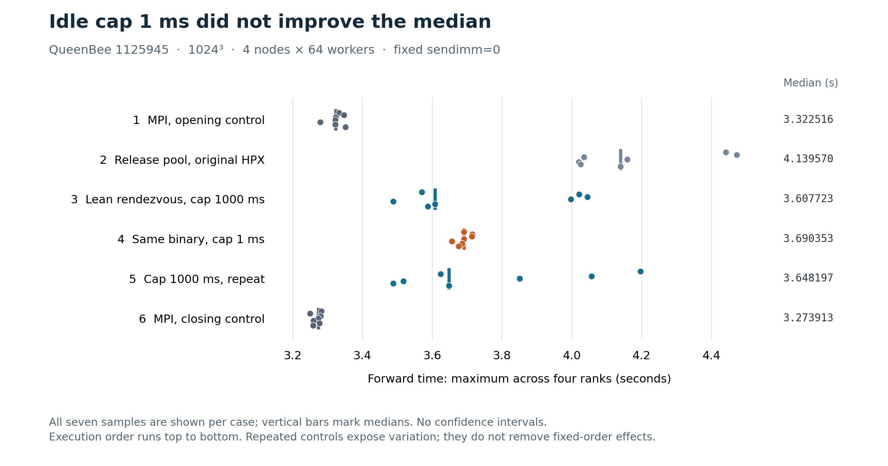

<!--
Copyright (c) 2026 Dominic C. Marcello

This document is free software; you can redistribute it and/or modify it
under the terms of the GNU General Public License as published by the Free
Software Foundation; either version 2 of the License, or (at your option)
any later version.

This document is distributed in the hope that it will be useful, but WITHOUT
ANY WARRANTY; without even the implied warranty of MERCHANTABILITY or FITNESS
FOR A PARTICULAR PURPOSE. See the GNU General Public License for more details.

You should have received a copy of the GNU General Public License along with
this document; if not, write to the Free Software Foundation, Inc.,
51 Franklin Street, Fifth Floor, Boston, MA 02110-1301 USA.
-->

# Readiness progress control: QueenBee job 1125945

Reducing the idle backoff cap from 1000 ms to 1 ms did not improve the
median in this allocation. Its median was 2.29% above the initial 1000 ms
control and 1.16% above the repeated control. Retain 1000 ms on this evidence.
All six cases passed, including 42 timed samples, 18 numerical checks, matching
normalized forward/backward plans, and both assertion-enabled communication
gates. [SUMMARY.json](SUMMARY.json) contains every sample and the independent
reduction; [raw results](raw/1125945/progress_comparison.json) are preserved
unchanged.

| Execution order and case | Median (s) | Mean (s) | Minimum (s) | Maximum (s) |
| --- | ---: | ---: | ---: | ---: |
| 1. MPI, opening control | 3.322516 | 3.325116 | 3.279068 | 3.350709 |
| 2. Release pool, original HPX | 4.139570 | 4.184618 | 4.019755 | 4.472931 |
| 3. Lean rendezvous, cap 1000 ms | 3.607723 | 3.759351 | 3.488180 | 4.044059 |
| 4. Same lean binary, cap 1 ms | 3.690353 | 3.689498 | 3.656340 | 3.714992 |
| 5. Same lean binary, cap 1000 ms, repeat | 3.648197 | 3.768525 | 3.487726 | 4.196161 |
| 6. MPI, closing control | 3.273913 | 3.268457 | 3.249378 | 3.281660 |



The MPI closing median was 1.46% lower than its opening median. The repeated
1000 ms HPX median was 1.12% higher than its initial median. The 1 ms case had
a narrower observed range and lower mean than both 1000 ms runs; all these
statistics are retained rather than selecting only favorable samples. Seven
successive samples from one allocation and a fixed case order do not establish
independent uncertainty estimates or a causal explanation for the spread. No
confidence intervals are shown. The source-backed sleep-path hypothesis in
[parcelport_path.md](../parcelport_path.md) remains a mechanism to investigate;
this experiment neither proves nor rules out individual readiness wakeup delays.

## Controlled comparison

The unchanged benchmark used a 1024³ double-precision, in-place complex transform,
normal layout, `FFTW_ESTIMATE`, two warmups, and seven measured forwards per case.
Each reported time is the maximum elapsed forward time across four ranks.
Inverse transforms and correctness checks are outside that forward timer.
The allocated nodes were `qbd007`, `qbd008`, `qbd009`, and `qbd460`, with one
rank per node and 64 workers per rank. Placement was `numactl --interleave=all`
without MPI or HPX CPU binding. [runtime.txt](raw/1125945/runtime.txt),
[node inventory](raw/1125945/node_inventory.log), and every exact launch command
are included.

All three lean runs used the identical previously built executable, identical
HPX/MPI shared-library environment, `sendimm=0`, one MPI parcelport background
worker, one global background worker, MPI multithreading enabled, and TCP
disabled. Comparing launch tokens verifies that only
`hpx.max_idle_backoff_time` changed: 1000 → 1 → 1000 ms. The default idle-loop
threshold remained 200000 and the busy-loop threshold was not overridden.
The two MPI commands are identical. Both HPX communication gates used the same
lean assertion-enabled checker at four localities × two workers, once per idle
cap, and each logged four rank-level `communication check PASS` lines.

The normalized plans are identical across all six cases; all four HPX plan
prints are byte-identical before normalization. All full-spectrum, initial
roundtrip, and final roundtrip checks passed their `1e-10` tolerance. The largest
reported relative error was `5.9257913899479424e-15`. The job recorded 20 passing
stages, a final exit status of zero, and empty scheduler stderr. Accounting was
not yet collected when this package was made;
[the original pending note](raw/1125945/accounting_pending.txt) is preserved.

## Provenance and reproduction

This was a runtime-only job: it compiled no sources and reused the original MPI,
release pool, lean rendezvous, and lean assertion-checker executables.
[SOURCE_VERIFICATION.json](SOURCE_VERIFICATION.json) verifies the eight copied
prior receipts against the published [1125925 confirmation](../confirmation/README.md),
the eight frozen job inputs, and the executed job/common/provenance copies.
The rendezvous source is the already validated
[bridge](../integration/validated_inputs/hpx/hpx-comm.cpp), SHA-256
`cf160a561ec182410f343aa47e04458b8adc4b847a56545e8bd284ef8e43905c`.
The reused lean executable is recorded as SHA-256
`42c8821d64faaf27411e1714fe05ed37d4feb4aa21fe79d4db6ec1b742f66496`.
The unchanged primary driver has SHA-256
`9327f8e3e9bb4a78509e7e12f11c093125dd67cdc0ab6b56fbdb8728fc7c4d41`.

The job verified 36 fixed inputs, four reused binaries, and 150 prior-artifact
checks both before and after execution. Loader checks selected the isolated lean
HPX prefix and the original OpenMPI 5.0.11 prefix, with no APEX library. Those
cluster hash receipts are preserved; omitted executables and archives cannot be
locally rehashed from this compact text package. No binaries, object files,
archives, or duplicate full source trees are included.

[SOURCE_MAP.json](SOURCE_MAP.json) records all 75 byte-identical copied files and
their hashes, plus three omitted duplicate logs with original hashes and reasons.
It retains the six complete benchmark logs, commands, all preservation and
loader records, statuses, and eight prior receipts. The frozen eight-file input
bundle and its original manifest are under [inputs/progress](inputs/progress/README.md).
The package manifest also covers the new reduction script, summary, notes, and
figure outputs.

From this directory, validate and independently regenerate the summary with:

```sh
sha256sum -c SHA256SUMS
(cd inputs && sha256sum -c progress/SHA256SUMS)
python3 -I recompute.py > /tmp/fftw_progress_summary.json
cmp SUMMARY.json /tmp/fftw_progress_summary.json
```

The reduction verifies the complete sample/check matrices, statistics, plans,
commands, status and preservation receipts, and reproduces the job's comparison
JSON values exactly. Regenerate the PNG/SVG with `python3 plot_samples.py`
(requires Matplotlib). The figure contains measured samples and median strokes,
without inferred error bars. All new code, notes, summaries, and figures in this
package are licensed under GPL-2.0-or-later.
