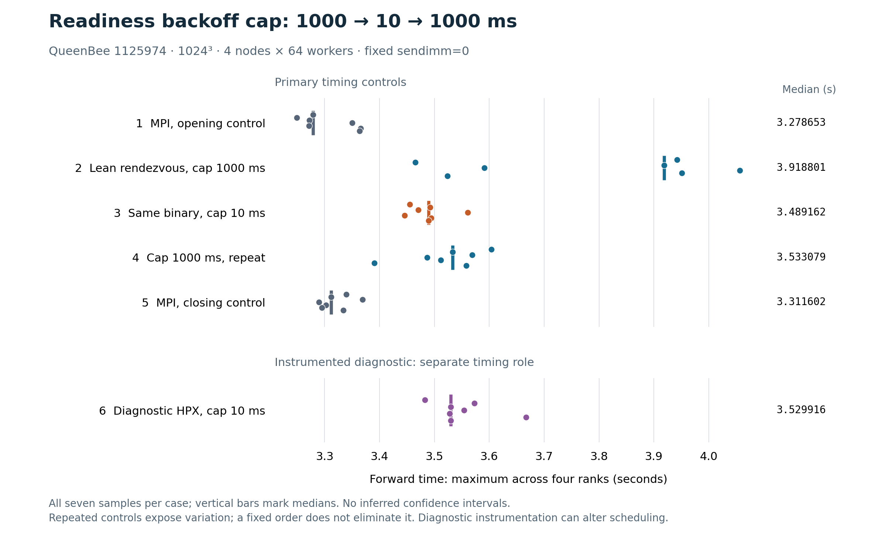

<!-- Copyright (c) 2026 Dominic C. Marcello. SPDX-License-Identifier: GPL-2.0-or-later -->

# Readiness backoff comparison, QueenBee 1125974

The cap 10 ms clean median was 3.489161787 s: -10.96% relative to the initial cap 1000 ms control and -1.24% relative to its repeat. MPI bookend medians changed +1.00%. These are observed comparisons in one allocation; the controls remain separate. It remained 5.36–6.42% above the MPI bookend medians; this does not close the full gap.

| Run | Role | Median (s) | Range (s) |
|---|---|---:|---:|
| MPI opening control | primary | 3.278653075 | 3.249225–3.365882 |
| Lean cap 1000 ms | primary | 3.918800902 | 3.465386–4.056532 |
| Lean cap 10 ms | primary | 3.489161787 | 3.445888–3.560634 |
| Lean cap 1000 ms repeat | primary | 3.533079093 | 3.390573–3.603847 |
| MPI closing control | primary | 3.311601999 | 3.289579–3.369088 |
| Diagnostic HPX cap 10 ms | diagnostic | 3.529916349 | 3.482905–3.667135 |

All six cases keep the unchanged 1024³ double-complex FFTW_ESTIMATE workload,
in-place normal layout, four exclusive nodes, one rank per node and 64 FFT workers,
two warmups and seven measured forwards. Both MPI bookends reuse the original
binary. The three clean lean runs reuse exactly one rendezvous executable with
only `hpx.max_idle_backoff_time` changing 1000 → 10 → 1000 ms. Sendimm remains 0,
MPI/global background limits remain 1, MPI multithreading remains 1, and the idle
loop threshold is unchanged. TCP is disabled; payload transport remains MPI/UCX
`rc,sm,self`, with `numactl --interleave=all` and no binding. The inherited MPI
thread-level environment is recorded and preserved, never forced or cleared.

The separate diagnostic cap 10 run reuses the job 1125966 instrumented binary.
Its absolute phase times describe this run; no previous-allocation MPI profile
is paired with it. Instrumentation can change scheduling, and readiness includes
peer arrival and validation as well as transport progress. It is not pure network
latency. Nested counters cannot be added to the disjoint exchange phases.

Across the seven diagnostic samples, the actual critical rank averaged 0.126788 s in readiness, 0.321021 s in receive wait and 0.057460 s in send-completion wait. The diagnostic median was 1.17% above the clean cap 10 ms median. All 168 required direct loads completed with zero owned fallback and zero final receive-copy bytes. These are instrumented within-run measurements.

Separately, job 1125966 at cap 1000 ms had mean critical-rank readiness 0.431114 s and maximum per-sample, per-rank accumulated readiness 0.847801 s, versus 0.126788 s and 0.237570 s here. Mean critical-rank process CPU increased from 122.855709 to 171.395749 CPU-seconds (+39.51%), while callback thread CPU stayed close (49.014608 versus 48.923924 CPU-seconds). Process CPU sums the rank process threads; it is not wall time or a four-node total. These different allocations and selected critical ranks make this a CPU-cost observation, not an isolated causal estimate.

All 42 samples, 18 numerical checks, six plan pairs, two 4-rank × 2-worker communication gates,
pre/post input and executable hashes, exact launch arguments and prior artifact
proofs are checked by [recompute.py](recompute.py). The clean commands differ
only by the cap, repeated controls are retained separately, and the original
serial/thread/MPI archives were reused without rebuilding. Binary and archive
hashes are cluster receipts; those binaries are intentionally not published.
One fixed-order cohort does not eliminate temporal/node variation or establish
a general causal explanation.

The eight submitted inputs are preserved byte-for-byte under
[inputs/readiness_progress](inputs/readiness_progress). Raw benchmark logs,
four per-rank profile logs, full commands, metadata, status and preservation
receipts are under [raw/1125974](raw/1125974). The complete analyzer JSON with all
28 rank-samples and 1,064 metric records appears once in
[raw/1125974/hpx_profile10.json](raw/1125974/hpx_profile10.json).
`SUMMARY.json` contains compact statistics and counter totals without repeated
full plans. Duplicate assembled analysis/combined stdout/JSON logs are excluded
with their hashes recorded in `SOURCE_MAP.json`; the analysis log is reconstructed
from raw fragments. No binary, object, archive or copied FFTW source tree is
included. `SOURCE_VERIFICATION.json` records each copy's digest and the verified
download archive. `SHA256SUMS` protects the published tree.

Recompute with `python3 -I recompute.py` and recreate the figure with
`python3 plot_samples.py`. Reproduction uses the unchanged analyzer published at
[../lean_profile/inputs/lean_profile/profile/analyze.py](../lean_profile/inputs/lean_profile/profile/analyze.py),
whose digest is recorded in the source map. Integer counters/nanoseconds compare
exactly; derived floating values permit only 5e−15 seconds of cross-Python rounding.
Accounting records [COMPLETED, exit 0:0](../accounting.txt) for job 1125974.

The prior [lean profiling report](../lean_profile/README.md) and
[cap 1 control report](../progress/README.md) remain distinct allocations.

This experimental code, documentation and evidence packaging are licensed under
GNU GPL version 2 or later; see repository `COPYING`. Original FFTW and HPX notices
are preserved. This package does not claim a new production configuration.
